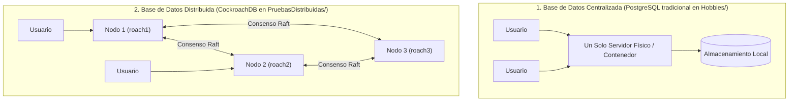
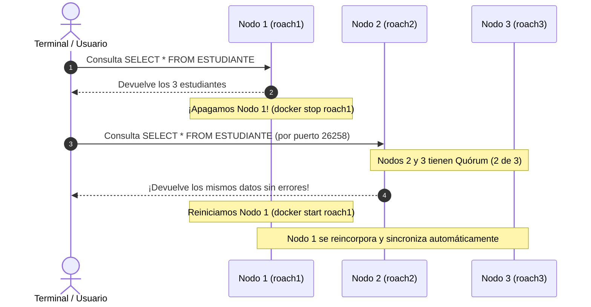
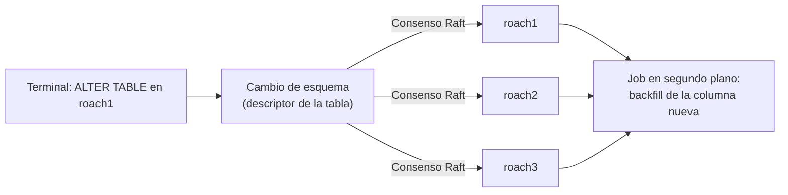

# 🚀 Guía de Base de Datos Distribuida: CockroachDB & Hobbies

Este documento explica de forma clara, didáctica y práctica qué es una base de datos distribuida, cómo funciona el clúster de **CockroachDB** configurado en esta carpeta, por qué tu configuración anterior no terminaba de arrancar y cómo montar tu base de datos SQL de `Hobbies/` sin fricciones.

---

## 📌 Tabla de Contenidos
1. [¿Servía el Docker que tenías? ¿Qué le faltaba?](#1-servía-el-docker-que-tenías-qué-le-faltaba)
2. [¿Qué es una Base de Datos Distribuida? (Explicación Sencilla)](#2-qué-es-una-base-de-datos-distribuida-explicación-sencilla)
3. [El Cambio: De PostgreSQL (`Hobbies/`) a CockroachDB (`PruebasDistribuidas/`)](#3-el-cambio-de-postgresql-hobbies-a-cockroachdb-pruebasdistribuidas)
4. [¿Cómo funciona CockroachDB por dentro? (Conceptos Clave)](#4-cómo-funciona-cockroachdb-por-dentro-conceptos-clave)
5. [Paso a Paso: Cómo Montar y Usar la Base de Datos](#5-paso-a-paso-cómo-montar-y-usar-la-base-de-datos)
6. [Dataset Masivo de Prueba (Distribución Equilibrada)](#6-dataset-masivo-de-prueba-distribución-equilibrada)
7. [Consola Web de Monitoreo (Admin UI)](#7-consola-web-de-monitoreo-admin-ui)
8. [Experimento en Vivo: Prueba de Tolerancia a Fallos (Matar un Nodo)](#8-experimento-en-vivo-prueba-de-tolerancia-a-fallos-matar-un-nodo)
9. [Comandos de Referencia Rápida](#9-comandos-de-referencia-rápida)
10. [Cómo Alterar el Dataset (Parámetros del Generador)](#10-cómo-alterar-el-dataset-parámetros-del-generador)
11. [Cómo Agregar Columnas a las Tablas en una Base de Datos Distribuida](#11-cómo-agregar-columnas-a-las-tablas-en-una-base-de-datos-distribuida)

---

## 1. ¿Servía el Docker que tenías? ¿Qué le faltaba?

**Sí, tu Docker sí servía en un 95%**, pero tenía un detalle crucial que impedía usarlo:

### El Problema:
En `docker-compose.yml` tenías definidos 3 nodos (`roach1`, `roach2`, `roach3`) que se buscaban entre sí mediante `--join=roach1:26357,roach2:26357,roach3:26357`. 

En CockroachDB, cuando se crea un clúster de múltiples máquinas por primera vez, **los nodos no empiezan a recibir conexiones hasta que reciben una orden de inicialización** (`cockroach init`). 
Como esa orden nunca se ejecutó, los 3 contenedores se quedaban esperando eternamente en un bucle:
> `Node will now attempt to join a running cluster, or wait for cockroach init.`

### La Solución que aplicamos:
1. Agregamos al `docker-compose.yml` un contenedor auxiliar (`cluster-init`) que envía automáticamente la orden de inicialización apenas arrancan los nodos.
2. Copiamos tu esquema y datos [Hobbies.sql](./Hobbies.sql) a esta carpeta.
3. Creamos el script automatizado [cargar_datos.sh](./cargar_datos.sh) para que con un solo comando crees la base de datos, las tablas y cargues los registros.

---

## 2. ¿Qué es una Base de Datos Distribuida? (Explicación Sencilla)

Para entenderlo, usemos una analogía cotidiana:



### La Analogía del Banco:
* **Base de datos tradicional (Centralizada):**
  Es como una sucursal con **un único cajero** que tiene el libro contable físico. Si ese cajero se enferma o la sucursal se queda sin luz, **el banco cierra por completo**. Si llegan 500 clientes al tiempo, la fila se vuelve lenta y la única solución es ponerle un escritorio más grande a ese único cajero (*Escalamiento Vertical*).

* **Base de datos distribuida (Clúster):**
  Es como tener **3 cajeros en paralelo** (`roach1`, `roach2`, `roach3`). Cada uno tiene una copia sincronizada del libro contable. 
  - Si un cliente le pide $100 al Cajero 1, los cajeros se comunican entre sí para registrar el retiro.
  - **Si el Cajero 1 se desmaya o se apaga, los Cajeros 2 y 3 siguen atendiendo normalmente sin perder un solo centavo de información** (*Tolerancia a fallos y Alta Disponibilidad*).
  - Si llegan miles de clientes, simplemente añades un Cajero 4, 5 o 6 (*Escalamiento Horizontal*).

---

## 3. El Cambio: De PostgreSQL (`Hobbies/`) a CockroachDB (`PruebasDistribuidas/`)

En la carpeta `Hobbies/` tenías un archivo `docker-compose.yml` con **PostgreSQL estándar** (puerto `5433`). 

¿Qué cambia al pasar a CockroachDB en `PruebasDistribuidas/`?

| Característica | PostgreSQL (`Hobbies/`) | CockroachDB (`PruebasDistribuidas/`) |
| :--- | :--- | :--- |
| **Arquitectura** | Monolítica (1 nodo centralizado) | Distribuida NewSQL (3 nodos independientes) |
| **Punto único de falla** | Sí (Si el contenedor cae, se detiene la BD) | No (Puede morir un nodo y el clúster sigue vivo) |
| **Lenguaje SQL** | SQL estándar | SQL estándar (dialecto PostgreSQL) |
| **Compatibilidad** | Nativo PostgreSQL | **100% compatible con protocolo y clientes PostgreSQL** |
| **Puertos de acceso** | Solo 1 puerto (`5433`) | **3 puertos distintos** (Nodo 1: `26257`, Nodo 2: `26258`, Nodo 3: `26259`) |
| **Consola Web de salud** | Requiere herramientas externas (pgAdmin) | **Consola Web nativa integrada** en `http://localhost:8080` |

> [!NOTE]
> **¿Por qué funcionó tu script `Hobbies.sql` sin cambiarle nada?**
> Porque CockroachDB es un motor **NewSQL**: adopta la sintaxis y el protocolo de red de PostgreSQL, pero por debajo almacena y coordina los datos de forma distribuida. No tuviste que aprender una sintaxis rara ni renunciar a tus llaves foráneas (`FOREIGN KEY`) ni a tus `JOIN`.

---

## 4. ¿Cómo funciona CockroachDB por dentro? (Conceptos Clave)

### 1. Nodos (*Nodes*)
Cada contenedor (`roach1`, `roach2`, `roach3`) es un nodo del clúster. Todos los nodos son iguales; **no hay un "nodo maestro" ni un "esclavo"**. Puedes conectarte a cualquiera de ellos para leer o escribir.

### 2. Particionamiento por Rangos (*Ranges / Shards*)
CockroachDB divide tus tablas (`ESTUDIANTE`, `HOBBY`, `REALIZACION_HOBBY`, etc.) en bloques continuos de datos ordenados por su Llave Primaria llamados **Rangos** (por defecto de ~64 MB). Si tu tabla crece mucho, automáticamente se divide en más rangos y se reparten entre las máquinas.

### 3. Replicación y Algoritmo de Consenso (Raft & Quórum)
Cada Rango no se guarda en una sola máquina: **se replica 3 veces** (una copia en `roach1`, una en `roach2` y una en `roach3`).
- Cuando haces un `INSERT`: CockroachDB usa el protocolo **Raft**. Para confirmar que el dato se guardó, necesita que la **mayoría estricta (Quórum)** confirme la escritura.
- En un clúster de 3 nodos, la mayoría es: $\lfloor 3 / 2 \rfloor + 1 = \mathbf{2 \text{ nodos}}$.
- Por tanto, basta con que 2 nodos estén vivos para que todo el sistema funcione a la perfección.

### 4. Enrutamiento Inteligente
Si te conectas a `roach1` y pides un dato que físicamente está almacenado en el disco de `roach3`, tú no tienes que saberlo: `roach1` le pide el dato a `roach3` internamente a través de la red interna y te lo entrega como si estuviera en su propia memoria.

---

## 5. Paso a Paso: Cómo Montar y Usar la Base de Datos

### Paso 1: Levantar el Clúster
Desde esta carpeta (`PruebasDistribuidas/`), ejecuta en tu terminal:

```bash
docker compose up -d
```

Verás que se levantan:
- `roach1`: Nodo 1 (Puerto SQL: `26257`, Web UI: `8080`)
- `roach2`: Nodo 2 (Puerto SQL: `26258`, Web UI: `8081`)
- `roach3`: Nodo 3 (Puerto SQL: `26259`, Web UI: `8082`)
- `roach-init`: Contenedor que inicializa el clúster y luego se apaga pacíficamente.

Para comprobar que los 3 nodos están vivos:
```bash
docker exec -i roach1 ./cockroach node status --insecure --host=roach1:26257
```

---

### Paso 2: Cargar tu Base de Datos en el Clúster
Hemos preparado un único script ejecutable que hace todo el proceso de forma automática:

```bash
./cargar_datos.sh
```

El script se encarga de:
1. Crear la base de datos `hobbies` si no existe.
2. Cargar las tablas y el dataset desde [cargar_datos.sql](./cargar_datos.sql) (o el esquema inicial ligero con `./cargar_datos.sh Hobbies.sql`).
3. Mostrar el conteo final de filas de las 5 tablas para validar la carga.

---

### Paso 3: Probar las Consultas SQL
Puedes ejecutar las mismas 16 consultas de [consultas.sql](./consultas.sql) contra el clúster con este comando:

```bash
docker exec -i roach1 ./cockroach sql --insecure --host=roach1:26257 --database=hobbies < consultas.sql
```

O abrir una terminal SQL interactiva dentro de cualquier nodo:

```bash
# Conectarse interactivamente a roach1:
docker exec -it roach1 ./cockroach sql --insecure --host=roach1:26257 --database=hobbies

# O conectarse a roach2:
docker exec -it roach2 ./cockroach sql --insecure --host=roach2:26257 --database=hobbies
```

Dentro de la terminal puedes escribir cualquier SQL:
```sql
SELECT * FROM ESTUDIANTE;
SELECT e.NOMBRE, h.NOMBRE AS HOBBY FROM ESTUDIANTE e JOIN ESTUDIANTE_HOBBY eh ON eh.ESTUDIANTE_ID = e.ID JOIN HOBBY h ON h.ID = eh.HOBBY_ID;
```

---

### Paso 4: Conectarte desde un Gestor Visual (DBeaver, TablePlus, DataGrip, VS Code)
CockroachDB habla el mismo protocolo que PostgreSQL, por lo que en tu cliente gráfico favorito eliges **PostgreSQL** con estos datos:

- **Host:** `localhost` (o `127.0.0.1`)
- **Port:** `26257` (Nodo 1) o `26258` (Nodo 2) o `26259` (Nodo 3)
- **Database:** `hobbies`
- **User:** `root`
- **Password:** *(dejar vacío, no tiene contraseña)*
- **SSL:** `Disable` / Desactivado (modo insecure)

---

## 6. Dataset Masivo de Prueba (Distribución Equilibrada)

Para evaluar el comportamiento, particionamiento y rendimiento del clúster distribuido, se generó un dataset realista donde **las relaciones de muchos a muchos (N:M) existen en los datos y no solo en el esquema**. Todo sale de [generate_dataset.py](./generate_dataset.py) y es 100% reproducible (semilla fija).

### Archivos CSV Generados:
Todos los archivos se encuentran disponibles en la carpeta [`datos_csv/`](./datos_csv/):

| Tabla | Archivo CSV | Registros | Descripción de Campos |
| :--- | :--- | :--- | :--- |
| `ESTUDIANTE` | [`estudiante.csv`](./datos_csv/estudiante.csv) | **500** filas | `id`, `nombre`, `edad` (18-32), `correo_electronico` |
| `HOBBY` | [`hobby.csv`](./datos_csv/hobby.csv) | **250** filas | `id`, `nombre` (50 actividades × modalidades) |
| `RECOMPENSA` | [`recompensa.csv`](./datos_csv/recompensa.csv) | **250** filas | `id`, `nombre` (bonos, descuentos, insignias), `valor` (10 a 500) |
| `ESTUDIANTE_HOBBY` | [`estudiante_hobby.csv`](./datos_csv/estudiante_hobby.csv) | **2.042** filas | `estudiante_id`, `hobby_id` — 2 a 6 hobbies por estudiante |
| `REALIZACION_HOBBY` | [`realizacion_hobby.csv`](./datos_csv/realizacion_hobby.csv) | **1.951** filas | `id`, `estudiante_id`, `hobby_id`, `recompensa_id`, `fecha` (2026) — 2 a 6 realizaciones por estudiante |

### ¿Por qué esta distribución es "equilibrada"?
* **Cada estudiante tiene VARIOS hobbies (entre 2 y 6):** antes la tabla intermedia tenía exactamente 1 fila por estudiante (una relación 1:1 disfrazada de N:M); ahora tiene ~4 en promedio, y el `JOIN` de la consulta 6 devuelve conteos distintos y realistas.
* **Cada estudiante tiene VARIAS realizaciones (entre 2 y 6):** las consultas de totales de recompensas por estudiante (9, 13 y 16 de `consultas.sql`) devuelven resultados variados y comparables entre sí.
* **Ningún hobby ni recompensa queda "huérfano":** el generador reparte con la técnica de *water-filling* (siempre elige entre los elementos menos usados hasta ese momento). Resultado: cada hobby lo practican 8-9 estudiantes y cada recompensa se entrega 7-8 veces.
* **Integridad garantizada por construcción:** cada fila de `REALIZACION_HOBBY` usa un par (`estudiante_id`, `hobby_id`) que existe en `ESTUDIANTE_HOBBY` (la llave foránea compuesta nunca se viola; el script lo verifica con un `assert` antes de escribir nada).
* **Fechas repartidas uniformemente** entre el 2026-01-01 y el 2026-10-24, para que la consulta 15 (rango de fechas) siempre tenga resultados en cualquier mes.

---

### 💡 Observación Clave: ¿Por qué usamos un `.sql` en vez de cargar directamente los `.csv` con SQL puro en CockroachDB?

Es muy natural preguntarse: *¿Por qué no simplemente ejecutar un comando SQL que lea los archivos `.csv` en vez de generar un archivo `.sql`?*

La respuesta se debe a la arquitectura interna y el modelo de licenciamiento de **CockroachDB**:

1. **`IMPORT INTO` es una característica Enterprise (comercial):** En CockroachDB nativo, el comando para ingesta masiva de archivos CSV es `IMPORT INTO`, pero está clasificado como función Enterprise (requiere licencia de pago).
2. **Almacenamiento remoto:** CockroachDB está diseñado para clústeres en la nube donde los nodos corren en servidores físicos diferentes. Por ello, `IMPORT INTO` no busca un archivo en la ruta local de tu computadora, sino que espera una URL de almacenamiento distribuido en red (como Amazon S3, Google Cloud Storage, Azure Blob o un servidor HTTP interno).
3. **Contenedores Docker mínimos:** Los contenedores oficiales de CockroachDB solo incluyen el binario del motor distribuido; no traen clientes adicionales para parsear archivos locales externos.

> [!NOTE]
> **Conclusión técnica:** Para un entorno de desarrollo o académico donde trabajamos con la versión gratuita y 100% contenida en Docker, el archivo [cargar_datos.sql](./cargar_datos.sql) es el estándar universal: se ejecuta a través del protocolo SQL estándar sin requerir licencias de pago, sin dependencias externas y cargando los datos en segundos dentro de Docker.
>
> *(Nota adicional)*: Como CockroachDB es compatible a nivel de red con PostgreSQL, herramientas cliente externas como `psql` pueden transferir CSVs con el comando cliente `\copy`, pero requieren tener PostgreSQL instalado localmente en el host. Para mantener el proyecto completamente autónomo y funcional únicamente con Docker, centralizamos la carga en el script unificado.

---

### Cómo Cargar los Datos al Clúster:
Solo necesitas ejecutar el único script unificado:

```bash
./cargar_datos.sh
```

El script se encarga de:
1. Verificar que la base de datos `hobbies` exista en el clúster.
2. Ejecutar [cargar_datos.sql](./cargar_datos.sql) para cargar el dataset completo (borra y recrea las tablas).
3. Imprimir el conteo de filas de las 5 tablas para validar la carga.

*(Opcional - Si quieres cargar el dataset inicial de 6 filas)*:
```bash
./cargar_datos.sh Hobbies.sql
```

*(Opcional - Si deseas regenerar los archivos CSV y SQL, por ejemplo tras cambiar la configuración de la sección 10)*:
```bash
python generate_dataset.py
```

---

## 7. Consola Web de Monitoreo (Admin UI)

CockroachDB incluye una consola web muy completa para ver la salud del clúster en tiempo real:

👉 Abre en tu navegador: **[http://localhost:8080](http://localhost:8080)**

¿Qué vas a encontrar allí?
1. **Cluster Overview:** Verás los 3 nodos con puntos verdes indicando que están sanos (*Healthy*).
2. **Databases:** Verás la base de datos `hobbies` con sus tablas y tamaño (verás reflejadas las ~500/250/2.000 filas por tabla del dataset).
3. **Metrics:** Gráficas de CPU, memoria, operaciones de lectura/escritura por segundo y latencia.
4. **Statements:** Lista de consultas ejecutadas recientemente y su tiempo de respuesta.

---

## 8. Experimento en Vivo: Prueba de Tolerancia a Fallos (Matar un Nodo)

Esta es la mejor prueba práctica para que veas en acción el poder de una base de datos distribuida frente a una tradicional:



### Pasos para replicar el experimento:

1. **Haz una consulta al Nodo 2 (puerto 26258):**
   ```bash
   docker exec -i roach2 ./cockroach sql --insecure --host=roach2:26257 --database=hobbies -e "SELECT NOMBRE FROM ESTUDIANTE;"
   ```
   *Resultado:* Verás a Ana, Luis y Sofía.

2. **Simula una catástrofe apagando el Nodo 1:**
   ```bash
   docker stop roach1
   ```

3. **Vuelve a hacer la consulta al Nodo 2 o al Nodo 3:**
   ```bash
   docker exec -i roach2 ./cockroach sql --insecure --host=roach2:26257 --database=hobbies -e "SELECT NOMBRE FROM ESTUDIANTE;"
   ```
   *Resultado:* **¡La base de datos sigue respondiendo al 100%!** No perdiste datos ni se cayó el servicio.

4. **Revisa la consola web:**
   Abre [http://localhost:8081](http://localhost:8081) (consola web del Nodo 2). Verás que reporta 1 nodo como *Dead / Suspect*, pero el clúster sigue operativo.

5. **Revive el Nodo 1:**
   ```bash
   docker start roach1
   ```
   El Nodo 1 se reintegrará automáticamente y recibirá las actualizaciones pendientes mediante Raft sin intervención manual.

---

## 9. Comandos de Referencia Rápida

| Acción | Comando |
| :--- | :--- |
| Iniciar clúster | `docker compose up -d` |
| Detener clúster | `docker compose stop` |
| Apagar y borrar contenedores | `docker compose down` |
| Borrar todo (incluyendo datos del disco) | `docker compose down -v` |
| Ver estado de los nodos | `docker exec -i roach1 ./cockroach node status --insecure --host=roach1:26257` |
| Cargar dataset masivo (ver sección 6) | `./cargar_datos.sh` |
| Cargar dataset inicial alternativo (6 registros) | `./cargar_datos.sh Hobbies.sql` |
| Regenerar CSVs y `cargar_datos.sql` (ver sección 10) | `python generate_dataset.py` |
| Entrar a la consola SQL | `docker exec -it roach1 ./cockroach sql --insecure --host=roach1:26257 --database=hobbies` |
| Ejecutar consultas.sql | `docker exec -i roach1 ./cockroach sql --insecure --host=roach1:26257 --database=hobbies < consultas.sql` |

---

## 10. Cómo Alterar el Dataset (Parámetros del Generador)

El dataset no está "quemado" en los archivos: sale de [generate_dataset.py](./generate_dataset.py), y todo lo que define su forma vive en el bloque `CONFIG` al inicio del script:

```python
CONFIG = {
    "semilla": 42,                        # misma semilla => mismos datos
    "num_estudiantes": 500,
    "num_hobbies": 250,
    "num_recompensas": 250,
    "hobbies_por_estudiante": (2, 6),     # (mínimo, máximo) por estudiante
    "realizaciones_por_estudiante": (2, 6),
    "fecha_inicio": date(2026, 1, 1),
    "fecha_fin": date(2026, 10, 24),
    "edad_min": 18, "edad_max": 32,
    "valor_min": 10, "valor_max": 500,
}
```

| Parámetro | Qué controla | Efecto en las tablas |
| :--- | :--- | :--- |
| `semilla` | Punto de partida del generador aleatorio | Mismo valor → exactamente los mismos datos; cámbialo para obtener otro "mundo" de datos con los mismos tamaños |
| `num_estudiantes` | Filas de `ESTUDIANTE` | Con 500 hay ~4.000 correos/nombres únicos combinados |
| `num_hobbies` | Filas de `HOBBY` | Se generan combinando las listas `actividades` (50) × `modalidades` (10) en rotación |
| `num_recompensas` | Filas de `RECOMPENSA` | Se generan combinando `tipos_recompensa` (10) × niveles |
| `hobbies_por_estudiante` | Rango de hobbies por estudiante | Define el total de `ESTUDIANTE_HOBBY` (~4 × estudiantes en promedio) |
| `realizaciones_por_estudiante` | Rango de realizaciones por estudiante | Define el total de `REALIZACION_HOBBY` (~4 × estudiantes en promedio) |
| `fecha_inicio` / `fecha_fin` | Rango de fechas de las realizaciones | Reparto uniforme; afecta la consulta 15 (rango de fechas) |
| `edad_min` / `edad_max` | Rango de edad de los estudiantes | Filas de `ESTUDIANTE` |
| `valor_min` / `valor_max` | Rango del valor de la recompensa | Filas de `RECOMPENSA` |

### Ejemplos rápidos

```python
# El doble de estudiantes:
"num_estudiantes": 1000,

# Más hobbies por estudiante (relación N:M más densa):
"hobbies_por_estudiante": (3, 10),       # ~3.250 filas en ESTUDIANTE_HOBBY

# Más realizaciones que hobbies (para estresar las consultas de totales):
"realizaciones_por_estudiante": (6, 14), # ~5.000 filas en REALIZACION_HOBBY

# Otro "mundo" de datos con los mismos tamaños:
"semilla": 7,
```

Después de editar, regenera y recarga:

```bash
python generate_dataset.py   # reescribe datos_csv/ y cargar_datos.sql
./cargar_datos.sh            # recarga el clúster
```

> [!TIP]
> También puedes editar las listas de catálogo (`nombres`, `apellidos`, `actividades`, `modalidades`, `tipos_recompensa`) para agregar más variedad. Si agregas actividades nuevas y subes `num_hobbies`, las combinaciones rotan solas.
>
> No te preocupes por romper la integridad: el generador **siempre** crea primero los pares (`estudiante`, `hobby`) y después construye las realizaciones sobre esos pares, y lo verifica con un `assert` antes de escribir un solo archivo.

### Cómo mantiene el equilibrio internamente
El script usa dos técnicas de reparto:

* **`repartir_sin_repetidos()`** (para los hobbies de cada estudiante): elige siempre entre los hobbies menos asignados hasta ese momento (*water-filling*), así ninguno queda sin usar y la diferencia entre el más y el menos popular es de apenas 1-2 estudiantes.
* **`repartidor_ciclico()`** (para las recompensas de cada realización): entrega los ids en pasadas completas barajadas, de modo que cada recompensa se usa ⌊total/250⌋ o ⌈total/250⌉ veces exactas.

---

## 11. Cómo Agregar Columnas a las Tablas en una Base de Datos Distribuida

Pregunta natural: *si quiero agregarle una columna a una tabla, ¿se hace igual que en PostgreSQL? ¿hay que hacerlo nodo por nodo?*

**Respuesta corta:** el SQL es idéntico (`ALTER TABLE ... ADD COLUMN`) y **solo se ejecuta una vez, en cualquier nodo**. La parte distribuida la resuelve el clúster solo.

### El SQL (funciona tal cual en CockroachDB)

```sql
-- Columna opcional (acepta NULL): lo más simple
ALTER TABLE ESTUDIANTE ADD COLUMN TELEFONO VARCHAR(20);

-- Columna obligatoria: en CockroachDB, NOT NULL exige DEFAULT,
-- porque hay que rellenar las 500 filas que ya existen
ALTER TABLE ESTUDIANTE ADD COLUMN SEMESTRE INT NOT NULL DEFAULT 1;

-- Verificar el resultado
SHOW COLUMNS FROM ESTUDIANTE;
```

### ¿Qué pasa "detrás de cámaras" en el clúster distribuido?



1. **El esquema también es dato replicado.** La definición de cada tabla (su *descriptor*: columnas, tipos, llaves) se guarda y replica con el mismo mecanismo de consenso **Raft** que las filas. Por eso ejecutas el `ALTER` una sola vez en un nodo y los tres (`roach1`, `roach2`, `roach3`) llegan al mismo acuerdo. **No hay que repetir el cambio en cada nodo.**
2. **Es un cambio *online* (sin caída del servicio).** Las lecturas y escrituras sobre la tabla siguen funcionando mientras el cambio se aplica; no se apaga el clúster ni se bloquea la tabla.
3. **El relleno de las filas existentes es un *job* en segundo plano.** Si la columna trae `DEFAULT`, CockroachDB lanza una tarea de *backfill* que actualiza las filas viejas sin bloquear la operación normal. Puedes vigilarla:
   ```sql
   SHOW JOBS;
   ```

### Reglas prácticas en CockroachDB

| Quieres... | Se hace así | Detalle importante |
| :--- | :--- | :--- |
| Agregar columna opcional | `ALTER TABLE t ADD COLUMN col INT;` | Instantáneo; las filas viejas quedan con `NULL` |
| Agregar columna obligatoria | `ALTER TABLE t ADD COLUMN col INT NOT NULL DEFAULT x;` | El `DEFAULT` es **obligatorio**: define con qué valor se rellenan las filas existentes |
| Que sea única | Primero `ADD COLUMN`, luego `CREATE UNIQUE INDEX idx ON t(col);` | Mejor en dos pasos separados |
| Eliminarla | `ALTER TABLE t DROP COLUMN col;` | Borrado lógico: el espacio en disco no se libera de inmediato |
| Cambiarle el tipo | `ALTER TABLE t ALTER COLUMN col SET DATA TYPE ...;` | Solo conversiones compatibles |

> [!WARNING]
> En este dataset (cientos/miles de filas) todo lo anterior es casi instantáneo. En tablas de millones de filas el *backfill* puede tardar; ahí conviene agregar la columna con `DEFAULT NULL` primero y rellenarla después en lotes.

### Hacer el cambio permanente en el generador

Un `ALTER TABLE` cambia la tabla **que ya está cargada**, pero si mañana regeneras el dataset con `python generate_dataset.py`, el `cargar_datos.sql` volvería a nacer sin tu columna. Para que la columna nueva quede integrada en el dataset, agrégala en los **4 puntos** de `generate_dataset.py` donde vive la tabla (ejemplo con `ESTUDIANTE` y una columna `SEMESTRE`):

```python
# 1) La fila: el dict que genera cada estudiante
estudiantes.append({
    ...,
    "semestre": random.randint(1, 10),
})

# 2) El encabezado del CSV
fieldnames=["id", "nombre", "edad", "correo_electronico", "semestre"]

# 3) El CREATE TABLE dentro del .sql generado
f.write("    SEMESTRE INT,\n")

# 4) La lista de columnas del INSERT (y su tupla de valores)
escribir_inserts(
    "ESTUDIANTE",
    ["ID", "NOMBRE", "EDAD", "CORREO_ELECTRONICO", "SEMESTRE"],
    estudiantes,
    lambda e: (f"({e['id']}, {escape_sql(e['nombre'])}, {e['edad']}, "
               f"{escape_sql(e['correo_electronico'])}, {e['semestre']})"),
    f"-- 2. Insercion de {len(estudiantes)} ESTUDIANTES\n")
```

Y de nuevo el ciclo: `python generate_dataset.py && ./cargar_datos.sh`. Como `cargar_datos.sql` hace `DROP TABLE ... CASCADE` y recrea todo, la columna queda integrada desde la carga inicial sin ningún `ALTER` manual.

### ¿Y si la tabla nueva columna está en las tablas relacionales?
El mismo procedimiento sirve para `HOBBY`, `RECOMPENSA`, `ESTUDIANTE_HOBBY` y `REALIZACION_HOBBY`. Solo recuerda que las dos últimas participan en llaves foráneas compuestas: si la columna nueva debe ser llave foránea, créala primero como columna normal (`ADD COLUMN`) y agrega la restricción después en un paso separado (`ALTER TABLE ... ADD CONSTRAINT ... FOREIGN KEY ...`).

