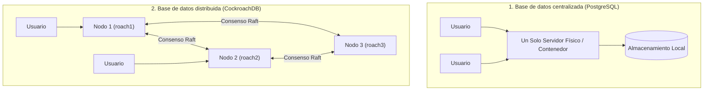
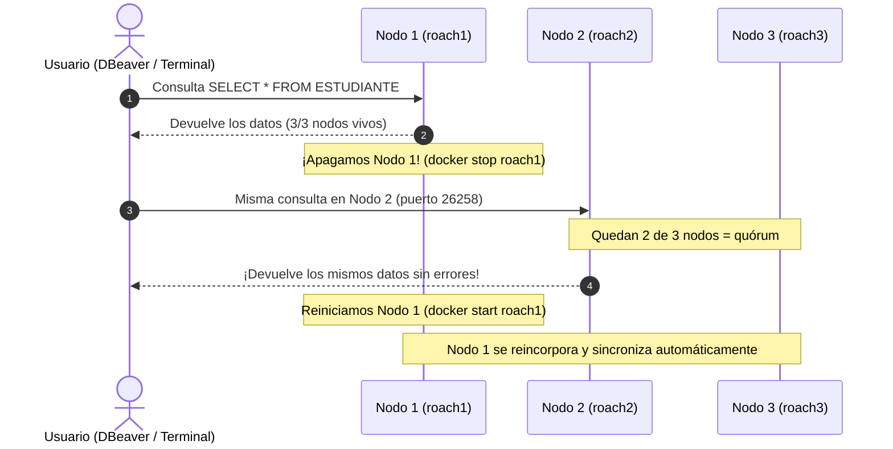

# Taller: Base de Datos Distribuida con CockroachDB

Este taller recorre el proceso completo, de inicio a fin, para implementar y probar una base de datos distribuida con **CockroachDB**, Docker y la base de datos de ejemplo *Hobbies*: desde la introducción y los conceptos clave, pasando por la creación del clúster de 3 nodos y la carga de datos, hasta la ejecución de los experimentos (replicación, cambios de esquema, tolerancia a fallos y rendimiento) con sus resultados y conclusiones.

Lo que se hace en el taller, en orden:

1. **Introducción y conceptos clave:** qué es una base de datos distribuida, en qué se diferencia PostgreSQL de CockroachDB y cómo funciona CockroachDB por dentro (nodos, rangos, Raft y quórum).
2. **Creación del clúster y los nodos:** levantar los 3 nodos con Docker, cargar el dataset, probar consultas por terminal y conectarse desde DBeaver.
3. **Experimentos y resultados:** replicación de escrituras entre nodos, `ALTER TABLE` sobre una columna nueva, tolerancia a fallos (1 y 2 nodos caídos) y pruebas de rendimiento (1 nodo vs clúster completo), registrando los resultados obtenidos.

El esquema viene de la parte relacional del curso y aquí se ejecuta sobre un motor distribuido. La idea es observar en local lo que un servidor centralizado no muestra: las tablas se dividen en rangos, cada rango tiene tres réplicas y una escritura se confirma cuando la mayoría de los nodos la acepta. Al final se apaga un nodo para comprobar que el clúster sigue atendiendo.

## Tabla de contenidos
- [1. Introducción al taller](#1-introducción-al-taller)
- [2. ¿Qué es una Base de Datos Distribuida?](#2-qué-es-una-base-de-datos-distribuida)
  - [La analogía del banco](#la-analogía-del-banco)
- [3. Diferencias entre PostgreSQL y CockroachDB](#3-diferencias-entre-postgresql-y-cockroachdb)
- [4. Conceptos clave de CockroachDB](#4-conceptos-clave-de-cockroachdb)
  - [4.1 Nodos](#41-nodos)
  - [4.2 Particionamiento por rangos](#42-particionamiento-por-rangos)
  - [4.3 Replicación y consenso (Raft y quórum)](#43-replicación-y-consenso-raft-y-quórum)
  - [4.4 Enrutamiento inteligente](#44-enrutamiento-inteligente)
- [5. Creación del clúster y los nodos (paso a paso)](#5-creación-del-clúster-y-los-nodos-paso-a-paso)
  - [Cómo se crean los nodos con Docker Compose](#cómo-se-crean-los-nodos-con-docker-compose)
  - [Paso 1: Levantar el clúster](#paso-1-levantar-el-clúster)
  - [Paso 2: Cargar los datos en el clúster](#paso-2-cargar-los-datos-en-el-clúster)
  - [Dataset de prueba](#dataset-de-prueba)
- [6. Probar las consultas SQL](#6-probar-las-consultas-sql)
  - [1. Desde terminal](#1-desde-terminal)
  - [2. O se puede conectar desde DBeaver](#2-o-se-puede-conectar-desde-dbeaver)
- [7. Consola web de monitoreo (Admin UI)](#7-consola-web-de-monitoreo-admin-ui)
- [8. Experimentos](#8-experimentos)
  - [Experimento 1: Replicación de escrituras entre nodos](#experimento-1-replicación-de-escrituras-entre-nodos)
  - [Experimento 2: ALTER TABLE con la columna PAIS](#experimento-2-alter-table-con-la-columna-pais)
  - [Experimento 3: Tolerancia a fallos (1 nodo caído y 2 nodos caídos)](#experimento-3-tolerancia-a-fallos-1-nodo-caído-y-2-nodos-caídos)
  - [Experimento 4: Rendimiento de un nodo vs clúster completo](#experimento-4-rendimiento-de-un-nodo-vs-clúster-completo)
- [9. Resultados y conclusiones](#9-resultados-y-conclusiones)

| Archivo | Uso |
| :--- | :--- |
| [`docker-compose.yml`](./docker-compose.yml) | Tres nodos de CockroachDB y el contenedor que inicializa el clúster. |
| [`cargar_datos.sh`](./cargar_datos.sh) | Crea la base `hobbies`, ejecuta el SQL y muestra el conteo final. |
| [`cargar_datos.sql`](./cargar_datos.sql) | Esquema y datos del dataset grande. |
| [`Hobbies.sql`](./Hobbies.sql) | Esquema original con 3 estudiantes, 3 hobbies, 3 recompensas y 6 realizaciones. |
| [`consultas.sql`](./consultas.sql) | 16 consultas de selección, JOIN y agregación. |
| [`generate_dataset.py`](./generate_dataset.py) | Genera los CSV y el `cargar_datos.sql` con una semilla fija. |
| [`datos_csv/`](./datos_csv/) | Los cinco CSV que produce el generador. |

## 1. Introducción al taller

El objetivo del taller es pasar de una arquitectura tradicional, donde toda la información se almacena en un único servidor, a una arquitectura **distribuida**, donde los datos se gestionan entre varios nodos que trabajan de manera coordinada.

Para eso se configura un clúster de tres nodos (`roach1`, `roach2`, `roach3`) con Docker, se migra la base de datos de ejemplo, se genera un conjunto de datos de prueba, se ejecutan consultas SQL desde DBeaver y se realizan diferentes pruebas para comprobar el funcionamiento del sistema: replicación de datos entre nodos, modificaciones de esquema, tolerancia a fallos y rendimiento.

---

## 2. ¿Qué es una Base de Datos Distribuida?

- Levantar un clúster de tres nodos con Docker Compose y comprobar su estado.
- Cargar un esquema con llaves foráneas, incluida una llave foránea compuesta.
- Ejecutar consultas de agregación sobre tablas que el motor reparte entre nodos.
- Seguir la salud del clúster y el movimiento de rangos en la consola web.
- Apagar un nodo y verificar que las lecturas y escrituras continúan.
- Cambiar el esquema en caliente y regenerar el dataset con otros tamaños.

## Modelo de datos



### La analogía del banco

* **Base de datos tradicional (centralizada):**
  Es como una sucursal con **un único cajero** que tiene el libro contable físico. Si ese cajero se enferma o la sucursal se queda sin luz, **el banco cierra por completo**. Si llegan 500 clientes al tiempo, la fila se vuelve lenta y la única solución es ponerle un escritorio más grande a ese único cajero (*Escalamiento Vertical*).

* **Base de datos distribuida (clúster):**
  Es como tener **3 cajeros en paralelo** (`roach1`, `roach2`, `roach3`). Cada uno tiene una copia sincronizada del libro contable.
  - Si un cliente le pide $100 al Cajero 1, los cajeros se comunican entre sí para registrar el retiro.
  - **Si el Cajero 1 se desmaya o se apaga, los Cajeros 2 y 3 siguen atendiendo normalmente sin perder un solo centavo de información** (*Tolerancia a fallos y Alta Disponibilidad*).
  - Si llegan miles de clientes, simplemente añades un Cajero 4, 5 o 6 (*Escalamiento Horizontal*).

En resumen, una base de datos distribuida ofrece dos ventajas principales frente a una centralizada:

1. **Tolerancia a fallos:** el sistema sigue funcionando aunque uno (o varios) nodos dejen de estar disponibles.
2. **Escalamiento horizontal:** se pueden agregar más nodos para repartir la carga, en lugar de depender solo de ampliar la capacidad de un único servidor.

---

## 3. Diferencias entre PostgreSQL y CockroachDB

En una base de datos **PostgreSQL** tradicional, toda la información vive en un único servidor: es una arquitectura **monolítica** con un punto único de falla. En **CockroachDB**, la información se divide y se replica entre varios nodos independientes que coordinan sus operaciones: es una arquitectura **distribuida (NewSQL)**.

| Característica | PostgreSQL (centralizada) | CockroachDB (distribuida) |
| :--- | :--- | :--- |
| **Arquitectura** | Monolítica (1 nodo centralizado) | Distribuida NewSQL (3 nodos independientes) |
| **Punto único de falla** | Sí (si el contenedor cae, se detiene la BD) | No (puede morir un nodo y el clúster sigue vivo) |
| **Dónde viven los datos** | En el disco de ese único servidor | Divididos en rangos y replicados en todos los nodos |
| **Escalamiento** | Vertical (más CPU/RAM al mismo servidor) | Horizontal (se agregan más nodos al clúster) |
| **Lenguaje SQL** | SQL estándar | SQL estándar (dialecto compatible con PostgreSQL) |
| **Clientes / protocolo** | Cliente PostgreSQL nativo | **100% compatible con el protocolo y clientes PostgreSQL** |
| **Puertos de acceso** | 1 solo puerto (`5433` en nuestra configuración original) | **3 puertos distintos** (Nodo 1: `26257`, Nodo 2: `26258`, Nodo 3: `26259`) |
| **Consola de salud** | Requiere herramientas externas (pgAdmin, etc.) | **Consola web nativa integrada** en `http://localhost:8080` |

> [!NOTE]
> **¿Por qué el mismo script SQL sirve para ambos motores?**
> Porque CockroachDB es un motor **NewSQL**: adopta la sintaxis y el protocolo de red de PostgreSQL, pero por debajo almacena y coordina los datos de forma distribuida. Por eso el mismo `CREATE TABLE`, las mismas llaves foráneas (`FOREIGN KEY`), los mismos `JOIN` y las mismas consultas funcionan sin cambios: no hay que reescribir la base de datos ni aprender una sintaxis nueva, solo cambiar el motor sobre el que corre.

## Puesta en marcha

## 4. Conceptos clave de CockroachDB

### 4.1 Nodos

Cada contenedor (`roach1`, `roach2`, `roach3`) es un nodo del clúster. Todos los nodos son iguales; **no hay un "nodo maestro" ni un "esclavo"**. Puedes conectarte a cualquiera de ellos para leer o escribir.

### 4.2 Particionamiento por rangos

CockroachDB divide tus tablas (`ESTUDIANTE`, `HOBBY`, `REALIZACION_HOBBY`, etc.) en bloques continuos de datos ordenados por su llave primaria llamados **Ranges** (rangos, por defecto de ~64 MB). Si tu tabla crece mucho, automáticamente se divide en más rangos y se reparte entre las máquinas.

### 4.3 Replicación y consenso (Raft y quórum)

Cada rango no se guarda en una sola máquina: **se replica 3 veces** (una copia en `roach1`, una en `roach2` y una en `roach3`).

- Cuando haces un `INSERT`, CockroachDB usa el algoritmo **Raft**. Para confirmar que el dato se guardó, necesita que la **mayoría estricta (quórum)** confirme la escritura.
- En un clúster de 3 nodos, la mayoría es: ⌊3 / 2⌋ + 1 = **2 nodos**.
- Por tanto, basta con que 2 nodos estén vivos para que todo el sistema siga funcionando a la perfección. Con 1 solo nodo vivo se pierde el quórum y el clúster deja de aceptar lecturas y escrituras (eso es exactamente lo que se observa en el Experimento 3).

### 4.4 Enrutamiento inteligente

Si te conectas a `roach1` y pides un dato que físicamente está almacenado en el disco de `roach3`, tú no tienes que saberlo: `roach1` le pide el dato a `roach3` internamente a través de la red y te lo entrega como si estuviera en su propia memoria. Por eso, desde el punto de vista del cliente, **los 3 nodos parecen una sola base de datos** (así lo veremos en el Experimento 1).

---

## 5. Creación del clúster y los nodos (paso a paso)

### Cómo se crean los nodos con Docker Compose

Los nodos no se crean a mano uno por uno: se declaran en el archivo [docker-compose.yml](./docker-compose.yml) y Docker Compose los crea y arranca todos juntos con el comando del Paso 1.

El archivo define 4 servicios:

- **`roach1`, `roach2`, `roach3`:** los 3 nodos de CockroachDB. Los tres usan la misma imagen oficial (`cockroachdb/cockroach`) y arrancan con `cockroach start --insecure`, más una lista `--join` con los 3 nodos (por el puerto `26357`, el que usan para hablar entre sí) para que al iniciarse se reconozcan y formen **un solo clúster**, no 3 bases de datos separadas.
- **`cluster-init`:** un contenedor auxiliar que ejecuta `cockroach init` una sola vez para crear el clúster; cuando termina, se apaga.

Y tres elementos compartidos por los nodos:

| Elemento del archivo | Qué hace |
| :--- | :--- |
| **Puertos** (`ports`) | Publica los puertos de cada nodo en tu máquina con números distintos para que no se pisen: SQL `26257` / `26258` / `26259` y consola web `8080` / `8081` / `8082`. Dentro de la red de Docker, todos escuchan en el mismo puerto (`26257`). |
| **Volúmenes** (`volumes`) | Un volumen por nodo (`roach1_data`, `roach2_data`, `roach3_data`) para que los datos persistan al reiniciar o detener los contenedores. |
| **Red** (`networks`) | La red interna `roachnet`, compartida por todos los servicios, donde los nodos se comunican entre sí usando sus nombres (`roach1`, `roach2`, `roach3`). |

> [!NOTE]
> Cada nodo corre en su propio contenedor y **todos son iguales: no hay un nodo principal**. Al conectarte a cualquiera de ellos, la respuesta la da el clúster completo, que se encarga de repartir y replicar los datos entre los tres.

### Paso 1: Levantar el clúster

Desde la carpeta del repositorio, ejecuta en tu terminal:

```bash
docker compose up -d
```

Con esto Docker Compose crea los contenedores definidos en el archivo y los deja corriendo:

- `roach1`: Nodo 1 (Puerto SQL: `26257`, Web UI: `8080`)
- `roach2`: Nodo 2 (Puerto SQL: `26258`, Web UI: `8081`)
- `roach3`: Nodo 3 (Puerto SQL: `26259`, Web UI: `8082`)
- `roach-init`: Contenedor que inicializa el clúster y luego se apaga.

Para comprobar que los 3 nodos están vivos:

```bash
docker exec -i roach1 ./cockroach node status --insecure --host=roach1:26257
```

Deberías ver los 3 nodos con estado `live`.

| Tabla | Filas |
| :--- | ---: |
| `ESTUDIANTE` | 500 |
| `HOBBY` | 250 |
| `RECOMPENSA` | 250 |
| `ESTUDIANTE_HOBBY` | 2.042 |
| `REALIZACION_HOBBY` | 1.951 |

### Paso 2: Cargar los datos en el clúster

**Opciones de ejecución del `cargar_datos`:**

1. **Carga completa (por defecto):** sin argumentos, el script ejecuta [cargar_datos.sql](./cargar_datos.sql), que crea las 4 tablas y carga el dataset completo (~2.580 registros):

   ```bash
   ./cargar_datos.sh              # Linux / macOS / WSL / Git Bash
   .\cargar_datos.ps1             # Windows PowerShell
   cargar_datos.bat               # Windows CMD
   ```

El script hace lo siguiente:

1. Crea la base de datos `hobbies` si no existe.
2. Ejecuta el archivo `.sql` indicado (por defecto `cargar_datos.sql`).
3. Muestra el conteo de filas de las 4 tablas para validar la carga.

---

### Dataset de prueba

Para poder evaluar el comportamiento, la distribución y el rendimiento del clúster, se generó un dataset de prueba con [generate_dataset.py](./generate_dataset.py), que produce de forma reproducible (semilla fija):

- Los archivos CSV de la carpeta [`datos_csv/`](./datos_csv/).
- El script [cargar_datos.sql](./cargar_datos.sql), que crea las tablas e inserta los registros en el clúster.

| Tabla | Archivo CSV | Registros | Contenido |
| :--- | :--- | :--- | :--- |
| `ESTUDIANTE` | [`estudiante.csv`](./datos_csv/estudiante.csv) | **500** filas | `id`, `nombre`, `edad` (18-32), `codigo` (11 dígitos, único) |
| `HOBBY` | [`hobby.csv`](./datos_csv/hobby.csv) | **40** filas | `id`, `nombre` — 40 hobbies fijos, sin replicación |
| `RECOMPENSA` | [`recompensa.csv`](./datos_csv/recompensa.csv) | **40** filas | `id`, `nombre` (una por hobby), `valor` (10 a 500) |
| `REALIZACION_HOBBY` | [`realizacion_hobby.csv`](./datos_csv/realizacion_hobby.csv) | **2.000** filas | `id`, `estudiante_id`, `hobby_id`, `recompensa_id`, `fecha` (2026) |

Detalles importantes del dataset:

- **Código de estudiante único** de 11 dígitos: `año` (2000-2026) + `semestre` (1 o 2) + `código de carrera` (010 a 090, de 10 en 10) + `consecutivo` (000 a 200). Ejemplos: `20221020098`, `20152050140`, `20201090069`. Nunca se repite (está marcado como `UNIQUE` en la tabla).
- **Hobbies y recompensas van 1 a 1:** la recompensa `N` es la que corresponde al hobby `N` (ej. hobby "Comer mocos" → recompensa "mocos de diferentes sabores").
- **Realizaciones equilibradas:** cada estudiante tiene entre 2 y 6 hobbies distintos y entre 2 y 6 realizaciones, cerrando en exactamente **2.000** filas; cada hobby y cada recompensa se usan entre 49 y 51 veces.
- **Fechas repartidas** entre `2026-01-01` y `2026-10-24`, para que las consultas por rango de fechas (consulta 15 de `consultas.sql`) tengan resultados en cualquier mes.

Para cargar el dataset al clúster se usa el script del **Paso 2** (`./cargar_datos.sh`). Si se desea regenerar los archivos CSV y `cargar_datos.sql`:

```bash
python generate_dataset.py
```

---

## 6. Probar las consultas SQL

### 1. Desde terminal

Se puede abrir una terminal SQL interactiva dentro de cualquier nodo:

```bash
# Conectarse interactivamente al Nodo 1:
docker exec -it roach1 ./cockroach sql --insecure --host=roach1:26257 --database=hobbies

# O conectarse al Nodo 2:
docker exec -it roach2 ./cockroach sql --insecure --host=roach2:26257 --database=hobbies
```

Dentro de la terminal puedes escribir cualquier SQL. Por ejemplo, para listar los estudiantes y ver cuánto "dinero" han ganado en recompensas, ordenado de mayor a menor:

```sql
SELECT * FROM HOBBY;

SELECT e.NOMBRE, COALESCE(SUM(r.VALOR), 0) AS total_recompensas
FROM ESTUDIANTE e
LEFT JOIN REALIZACION_HOBBY rh ON rh.ESTUDIANTE_ID = e.ID
LEFT JOIN RECOMPENSA r ON r.ID = rh.RECOMPENSA_ID
GROUP BY e.NOMBRE
ORDER BY total_recompensas DESC;
```

Y para ver los hobbies que más se realizaron, mostrando el hobby y al lado el total de estudiantes que lo practicó (de mayor a menor):

```sql
SELECT h.NOMBRE AS hobby, COUNT(DISTINCT rh.ESTUDIANTE_ID) AS total_estudiantes
FROM HOBBY h
JOIN REALIZACION_HOBBY rh ON rh.HOBBY_ID = h.ID
GROUP BY h.NOMBRE
ORDER BY total_estudiantes DESC, hobby;
```

> [!NOTE]
> Los puertos `26257`, `26258` y `26259` son los puertos **del host** (los que usa DBeaver desde tu máquina). Dentro de la red de Docker, todos los nodos escuchan en el puerto `26257`, por eso los comandos usan `--host=roach2:26257`, `--host=roach3:26257`, etc.

---

### 2. O se puede conectar desde DBeaver

CockroachDB habla el mismo protocolo que PostgreSQL, por lo que en DBeaver (u otro gestor visual como TablePlus, DataGrip o VS Code) eliges el conector **PostgreSQL** con estos datos:

- **Host:** `localhost` (o `127.0.0.1`)
- **Port:** `26257` (Nodo 1) o `26258` (Nodo 2) o `26259` (Nodo 3)
- **Database:** `hobbies`
- **User:** `root`
- **Password:** *(dejar vacío, no tiene contraseña)*
- **SSL:** `Disable` / Desactivado (modo insecure)

> [!TIP]
> Crea **3 conexiones** (una por nodo, por ejemplo "Nodo 1", "Nodo 2" y "Nodo 3"). Los experimentos de la sección 8 consisten, en gran parte, en ejecutar la misma sentencia en una conexión y verificar el resultado desde otra.

---

## 7. Consola web de monitoreo (Admin UI)

CockroachDB incluye una consola web para ver la salud del clúster en tiempo real. Es la herramienta que se usa en los experimentos de la sección 8 para observar métricas, estado de los nodos y tiempos de respuesta.

👉 Abre en tu navegador: **[http://localhost:8080](http://localhost:8080)** (consola del Nodo 1; las de los demás nodos están en `http://localhost:8081` y `http://localhost:8082`).

¿Qué vas a encontrar allí?

1. **Cluster Overview:** los 3 nodos con puntos verdes indicando que están sanos (*Healthy*).
2. **Databases:** la base de datos `hobbies` con sus tablas y tamaños.
3. **Metrics:** gráficas de CPU, memoria, operaciones de lectura/escritura por segundo y latencia.
4. **SQL Activity / Statements:** lista de consultas ejecutadas recientemente con su tiempo de respuesta y percentiles de latencia (clave para el Experimento 4).

---

## 8. Experimentos

Todos los experimentos se pueden realizar de dos formas: desde **DBeaver** (con una conexión por nodo) o desde la **terminal** con `cockroach sql`. Cada experimento indica ambos caminos y deja un espacio para registrar los resultados obtenidos.

- Conexiones DBeaver: Nodo 1 → `localhost:26257`, Nodo 2 → `localhost:26258`, Nodo 3 → `localhost:26259`.
- Terminales equivalentes: `docker exec -i roach1 ./cockroach sql --insecure --host=roach1:26257 --database=hobbies -e "..."` (y análogo con `roach2` y `roach3`).

### Experimento 1: Replicación de escrituras entre nodos

**Objetivo:** comprobar que un dato insertado en un nodo es visible desde los demás nodos, y viceversa. Los 3 nodos comparten un único estado de datos.

**Procedimiento en DBeaver:**

1. Conéctate al **Nodo 1** (`26257`) y ejecuta:

   ```sql
   INSERT INTO ESTUDIANTE (ID, NOMBRE, EDAD, CODIGO)
   VALUES (1000, 'Prueba Nodo 1', 25, '20261010001');

   SELECT * FROM ESTUDIANTE WHERE ID = 1000;
   ```

2. Sin desconectarte, abre la conexión al **Nodo 2** (`26258`) y verifica que el registro aparece:

   ```sql
   SELECT * FROM ESTUDIANTE WHERE ID = 1000;
   ```

3. Repite en sentido contrario: inserta desde el **Nodo 2** y verifica desde el **Nodo 3** (`26259`) o el **Nodo 1**:

   ```sql
   -- En Nodo 2 (26258)
   INSERT INTO ESTUDIANTE (ID, NOMBRE, EDAD, CODIGO)
   VALUES (2000, 'Prueba Nodo 2', 27, '20261010002');

   -- En Nodo 3 (26259) o Nodo 1 (26257)
   SELECT * FROM ESTUDIANTE WHERE ID IN (1000, 2000);
   ```

**Procedimiento por terminal (equivalente):**

```bash
# Escritura en el Nodo 1 y lectura desde el Nodo 2
docker exec -i roach1 ./cockroach sql --insecure --host=roach1:26257 --database=hobbies \
  -e "INSERT INTO ESTUDIANTE (ID, NOMBRE, EDAD, CODIGO) VALUES (9999, 'Prueba Nodo 1', 25, '20261010001');"

docker exec -i roach2 ./cockroach sql --insecure --host=roach2:26257 --database=hobbies \
  -e "SELECT * FROM ESTUDIANTE WHERE ID = 9999;"

# Escritura en el Nodo 2 y lectura desde el Nodo 3
docker exec -i roach2 ./cockroach sql --insecure --host=roach2:26257 --database=hobbies \
  -e "INSERT INTO ESTUDIANTE (ID, NOMBRE, EDAD, CODIGO) VALUES (9998, 'Prueba Nodo 2', 27, '20261010002');"

docker exec -i roach3 ./cockroach sql --insecure --host=roach3:26257 --database=hobbies \
  -e "SELECT * FROM ESTUDIANTE WHERE ID = 9998;"
```

**Limpieza** (ejecutar antes del Experimento 2, para que los registros de prueba no aparezcan en los conteos):

```sql
DELETE FROM ESTUDIANTE WHERE ID IN (1000, 2000);
```
---

### Experimento 2: ALTER TABLE con la columna PAIS

**Objetivo:** comprobar cómo se agrega una columna a una tabla dentro de una base de datos distribuida y verificar que el cambio se propaga a todos los nodos.

**Respuesta corta:** el SQL es idéntico al de cualquier PostgreSQL (`ALTER TABLE ... ADD COLUMN`) y **solo se ejecuta una vez, en cualquier nodo**. La parte distribuida la resuelve el clúster solo: la definición de la tabla (su *descriptor*: columnas, tipos, llaves) es un dato más, replicado con el mismo mecanismo de consenso **Raft** que las filas. Además es un cambio *online*: las lecturas y escrituras siguen funcionando mientras se aplica. Si la columna trae `DEFAULT`, el relleno de las filas existentes es un *job* en segundo plano que se puede vigilar con `SHOW JOBS`.

**Procedimiento en DBeaver:**

1. En el **Nodo 1** (`26257`), revisa la estructura actual y agrega la columna:

   ```sql
   -- Estructura antes del cambio
   SHOW COLUMNS FROM ESTUDIANTE;

   -- Columna opcional (acepta NULL): lo más simple
   ALTER TABLE ESTUDIANTE ADD COLUMN PAIS VARCHAR(50);

   -- Verificar el resultado
   SHOW COLUMNS FROM ESTUDIANTE;

   -- Ver el estado del relleno en segundo plano (backfill)
   SHOW JOBS;
   ```

   > [!NOTE]
   > En tablas pequeñas el *backfill* termina casi de inmediato. Si se quisiera una columna obligatoria, CockroachDB exige un `DEFAULT` para rellenar las filas que ya existen: `ALTER TABLE ESTUDIANTE ADD COLUMN PAIS VARCHAR(50) NOT NULL DEFAULT 'Colombia';`

2. **Verifica desde los demás nodos** (Nodo 2 `26258` y Nodo 3 `26259`) que el cambio ya está visible, sin haberlo ejecutado allí:

   ```sql
   SHOW COLUMNS FROM ESTUDIANTE;
   SELECT * FROM ESTUDIANTE WHERE ID = 1;
   ```

3. Pobla la columna y haz pruebas de consulta con ella (en cualquier nodo):

   ```sql
   UPDATE ESTUDIANTE SET PAIS = 'Colombia'  WHERE ID <= 250;
   UPDATE ESTUDIANTE SET PAIS = 'Mexico'    WHERE ID > 250 AND ID <= 400;
   UPDATE ESTUDIANTE SET PAIS = 'Argentina' WHERE ID > 400;

   -- Consulta 1: conteo por país
   SELECT PAIS, COUNT(*) AS total
   FROM ESTUDIANTE
   GROUP BY PAIS
   ORDER BY total DESC;

   -- Consulta 2: filtro por país
   SELECT ID, NOMBRE, PAIS
   FROM ESTUDIANTE
   WHERE PAIS = 'Colombia'
   ORDER BY ID;

   -- Consulta 3: totales de recompensas por país (la columna nueva, unida al resto del esquema)
   SELECT
       e.PAIS,
       COUNT(rh.ID) AS realizaciones,
       COALESCE(SUM(r.VALOR), 0) AS total_recompensas
   FROM ESTUDIANTE e
   LEFT JOIN REALIZACION_HOBBY rh ON rh.ESTUDIANTE_ID = e.ID
   LEFT JOIN RECOMPENSA r ON r.ID = rh.RECOMPENSA_ID
   GROUP BY e.PAIS
   ORDER BY total_recompensas DESC;
   ```

4. Verifica desde el **Nodo 2** y el **Nodo 3** que las consultas con `PAIS` devuelven exactamente los mismos resultados.

**Limpieza opcional:**

```sql
-- El espacio en disco no se libera de inmediato (borrado lógico)
ALTER TABLE ESTUDIANTE DROP COLUMN PAIS;
```

> [!WARNING]
> Si vuelves a ejecutar `./cargar_datos.sh`, las tablas se recrean desde `cargar_datos.sql` y la columna `PAIS` desaparece, ya que ese script vuelve a definir el esquema original.

---

### Experimento 3: Tolerancia a fallos (1 nodo caído y 2 nodos caídos)

**Objetivo:** comprobar en la práctica el quórum de Raft (2 de 3 nodos): qué pasa cuando se cae **1 nodo** y qué pasa cuando se caen **2 nodos**.



**Caso A: se cae 1 nodo (quedan 2 de 3 = quórum)**

1. Consulta base en el Nodo 2 (por terminal o en DBeaver):

   ```bash
   docker exec -i roach2 ./cockroach sql --insecure --host=roach2:26257 --database=hobbies \
     -e "SELECT COUNT(*) FROM ESTUDIANTE;"
   ```

2. Apaga el Nodo 1:

   ```bash
   docker stop roach1
   ```

3. Vuelve a consultar (lectura) y escribe un registro desde los nodos que siguen vivos:

   ```bash
   # Lectura desde el Nodo 2
   docker exec -i roach2 ./cockroach sql --insecure --host=roach2:26257 --database=hobbies \
     -e "SELECT COUNT(*) FROM ESTUDIANTE;"

   # Escritura desde el Nodo 3
   docker exec -i roach3 ./cockroach sql --insecure --host=roach3:26257 --database=hobbies \
     -e "INSERT INTO ESTUDIANTE (ID, NOMBRE, EDAD, CODIGO) VALUES (9997, 'Prueba Sin Nodo 1', 30, '20261010003');"

   # Escritura desde el Nodo 2
   docker exec -i roach2 ./cockroach sql --insecure --host=roach2:26257 --database=hobbies \
     -e "SELECT * FROM ESTUDIANTE WHERE ID = 9997;"
   ```

4. Revisa la consola web del Nodo 2: **[http://localhost:8081](http://localhost:8081)**. Verás 1 nodo reportado como *Dead / Suspect*, pero el clúster sigue operativo. También puedes verlo por terminal:

   ```bash
   docker exec -i roach2 ./cockroach node status --insecure --host=roach2:26257
   ```

**Caso B: se caen 2 nodos (queda 1 de 3 = sin quórum)**

1. Con el Nodo 1 ya apagado, apaga también el Nodo 2 (quedaría solo `roach3`):

   ```bash
   docker stop roach2
   ```

2. Intenta leer y escribir desde el único nodo vivo:

   ```bash
   # Lectura desde el Nodo 3
   docker exec -i roach3 ./cockroach sql --insecure --host=roach3:26257 --database=hobbies \
     -e "SELECT COUNT(*) FROM ESTUDIANTE;"

   # Escritura desde el Nodo 3
   docker exec -i roach3 ./cockroach sql --insecure --host=roach3:26257 --database=hobbies \
     -e "INSERT INTO ESTUDIANTE (ID, NOMBRE, EDAD, CODIGO) VALUES (9996, 'Prueba Sin Quorum', 30, '20261010004');"
   ```

   Se esperan errores o tiempos de espera (*timeout*): con 1 solo nodo vivo no hay quórum, así que el clúster **no puede confirmar ni lecturas ni escrituras**.

**Recuperación**

1. Enciende los nodos caídos:

   ```bash
   docker start roach1 roach2
   ```

2. Verifica que el clúster vuelve a estar completo y que **no se perdió ningún dato** (el registro insertado en el Caso A debe seguir ahí):

   ```bash
   docker exec -i roach1 ./cockroach node status --insecure --host=roach1:26257
   ```

   ```sql
   SELECT * FROM ESTUDIANTE WHERE ID IN (9996, 9997);
   ```

3. **Limpieza:**

   ```sql
   DELETE FROM ESTUDIANTE WHERE ID IN (9996, 9997);
   ```

---

### Experimento 4: Rendimiento de un nodo vs clúster completo

**Objetivo:** comparar cuánto tarda el mismo conjunto de consultas cuando se ejecutan contra **un solo nodo** y contra el **clúster completo de 3 nodos**, observando además las métricas en la consola web.

Para comparar de forma justa se necesitan dos entornos con el mismo dataset:

- **Escenario A (1 nodo):** una instancia independiente de CockroachDB con un único nodo.
- **Escenario B (3 nodos):** el clúster de [docker-compose.yml](./docker-compose.yml) (el que se levantó en el Paso 1).

**Paso 1: preparar el Escenario A (nodo único)**

```bash
# 1. Levantar un nodo independiente (puertos que no chocan con el clúster).
#    Nota: en la versión actual "start" exige --join; con un solo nodo el
#    --join se apunta a sí mismo (mismo patrón que docker-compose.yml).
docker run -d --name roach-single --hostname roach-single -p 26260:26257 -p 8090:8080 cockroachdb/cockroach start --insecure --listen-addr=roach-single:26357 --sql-addr=roach-single:26257 --http-addr=roach-single:8080 --join=roach-single:26357

# 2. Inicializar el nodo (init habla por el puerto RPC, 26357, no por el SQL)
docker exec -i roach-single ./cockroach init --insecure --host=roach-single:26357

# 3. Crear la base de datos y cargar el mismo dataset del clúster
docker exec -i roach-single ./cockroach sql --insecure --host=roach-single:26257 -e "CREATE DATABASE IF NOT EXISTS hobbies;"
docker exec -i roach-single ./cockroach sql --insecure --host=roach-single:26257 --database=hobbies < cargar_datos.sql
```

> [!NOTE]
> Si un intento anterior falló, puede quedar un contenedor `roach-single` muerto que impide volver a crearlo (error *"name already in use"*) o que responde *"is not running"* en el `init`. Elimínalo antes de reintentar:
>
> ```bash
> docker rm -f roach-single
> ```

En PowerShell, el comando de carga sería:

```powershell
cmd /c "docker exec -i roach-single ./cockroach sql --insecure --host=roach-single:26257 --database=hobbies < cargar_datos.sql"
```

Con esto quedan los dos escenarios listos, cada uno con su consola web:

- Escenario A (1 nodo): SQL en `localhost:26260`, consola en **[http://localhost:8090](http://localhost:8090)**
- Escenario B (3 nodos): SQL en `localhost:26257/26258/26259`, consola en **[http://localhost:8080](http://localhost:8080)**

**Paso 2: cómo medir**

Opción 1 — `EXPLAIN ANALYZE` (devuelve el tiempo real de ejecución de la consulta) con la siguiente consulta compleja:

```sql
EXPLAIN ANALYZE
SELECT
    e.ID,
    e.NOMBRE,
    h.NOMBRE AS HOBBY,

    COUNT(*) AS TOTAL_COMBINACIONES,

    SUM(r1.VALOR * r2.VALOR * r3.VALOR) AS SUMA_PRODUCTOS,

    AVG(
        ABS(r1.VALOR - r2.VALOR)::FLOAT8
    ) AS DIFERENCIA_PROMEDIO,

    MAX(
        POWER(
            (r1.VALOR * r2.VALOR * r3.VALOR)::FLOAT8,
            2
        )
    ) AS MAXIMO_CALCULADO,

    MIN(
        SQRT(
            ABS((r1.VALOR * r2.VALOR * r3.VALOR)::FLOAT8)
        )
    ) AS MINIMO_CALCULADO,

    SUM(
        SIN(r1.VALOR::FLOAT8) *
        COS(r2.VALOR::FLOAT8) *
        SIN(r3.VALOR::FLOAT8)
    ) AS CALCULO_TRIGONOMETRICO,

    SUM(
        LOG10(
            (r1.VALOR + r2.VALOR + r3.VALOR)::FLOAT8
        )
    ) AS CALCULO_LOGARITMICO,

    AVG(
        POWER(
            ABS(r1.VALOR - r2.VALOR + r3.VALOR)::FLOAT8,
            3
        )
    ) AS PROMEDIO_POTENCIAS

FROM ESTUDIANTE e

JOIN REALIZACION_HOBBY rh
    ON e.ID = rh.ESTUDIANTE_ID

JOIN HOBBY h
    ON rh.HOBBY_ID = h.ID

JOIN RECOMPENSA r1
    ON rh.RECOMPENSA_ID = r1.ID

CROSS JOIN REALIZACION_HOBBY rh2

JOIN RECOMPENSA r2
    ON rh2.RECOMPENSA_ID = r2.ID

CROSS JOIN REALIZACION_HOBBY rh3

JOIN RECOMPENSA r3
    ON rh3.RECOMPENSA_ID = r3.ID

WHERE
    rh2.ID <= 500
    AND rh3.ID <= 10

GROUP BY
    e.ID,
    e.NOMBRE,
    h.NOMBRE

ORDER BY
    SUMA_PRODUCTOS DESC;
```

Opción 2 — `\timing` en la shell interactiva:

```bash
docker exec -it roach-single ./cockroach sql --insecure --host=roach-single:26257 --database=hobbies
# o, para el clúster:
docker exec -it roach1 ./cockroach sql --insecure --host=roach1:26257 --database=hobbies
```

```sql
\timing on
SELECT COUNT(*) FROM REALIZACION_HOBBY rh JOIN RECOMPENSA r ON r.ID = rh.RECOMPENSA_ID;
```

Opción 2 — consola web (para ver las métricas agregadas):

- En **SQL Activity → Statements** aparecen las consultas ejecutadas con su latencia promedio y sus percentiles (p50/p95/p99).
- En **Metrics** están las gráficas de latencia y de operaciones de lectura/escritura por segundo.
- Escenario A: `http://localhost:8090` — Escenario B: `http://localhost:8080`.

**Resultados:**

| Consulta | Descripción | Tiempo 1 nodo (promedio) | Tiempo 3 nodos (promedio) | ¿Cuál fue más rápido? |
| :--- | :--- | :--- | :--- | :--- |
| 1 | Consulta compleja | 8.5 ms | 7.8 ms | 3 nodos |

**Limpieza del Escenario A:**

```bash
docker stop roach-single
docker rm roach-single
```


| Bloque | Consultas | Qué muestran |
| :--- | :--- | :--- |
| Selección y filtros | 1 a 4 | Listados, comparación de edad, `ILIKE` y orden. |
| JOIN | 5 a 7 | Hobbies por estudiante y realizaciones con sus tres catálogos. |
| Agregación | 8 a 12 | Totales por estudiante, hobby, recompensa y fecha. |
| Ranking y rangos | 13 a 16 | Mayor total, promedio, rango de fechas y `HAVING`. |

## 9. Resultados y conclusiones

**Resultados generales (rellenar):**

| Experimento | ¿Se cumplió lo esperado? | Resultado / evidencia observada |
| :--- | :--- | :--- |
| 1. Replicación de escrituras entre nodos | Sí / No | SI |
| 2. `ALTER TABLE` con la columna `PAIS` | Sí / No | SI |
| 3. Tolerancia a fallos con 1 nodo caído | Sí / No | SI |
| 3. Tolerancia a fallos con 2 nodos caídos | Sí / No | SI |
| 4. Rendimiento: 1 nodo vs 3 nodos | Sí / No | SI |

**Conclusiones (rellenar):**
