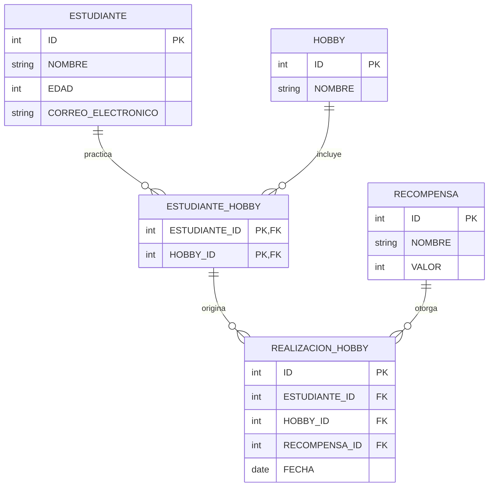

# Taller 1: clúster distribuido con CockroachDB

Este taller lleva el esquema relacional del proyecto Hobbies a un clúster de CockroachDB de tres nodos. La base guarda estudiantes, hobbies, recompensas y el historial de realizaciones. El dataset se genera con una semilla fija, así que las consultas devuelven los mismos resultados en cualquier equipo.

El esquema viene de la parte relacional del curso y aquí se ejecuta sobre un motor distribuido. La idea es observar en local lo que un servidor centralizado no muestra: las tablas se dividen en rangos, cada rango tiene tres réplicas y una escritura se confirma cuando la mayoría de los nodos la acepta. Al final se apaga un nodo para comprobar que el clúster sigue atendiendo.

## Contenido del repositorio

| Archivo | Uso |
| :--- | :--- |
| [`docker-compose.yml`](./docker-compose.yml) | Tres nodos de CockroachDB y el contenedor que inicializa el clúster. |
| [`cargar_datos.sh`](./cargar_datos.sh) | Crea la base `hobbies`, ejecuta el SQL y muestra el conteo final. |
| [`cargar_datos.sql`](./cargar_datos.sql) | Esquema y datos del dataset grande. |
| [`Hobbies.sql`](./Hobbies.sql) | Esquema original con 3 estudiantes, 3 hobbies, 3 recompensas y 6 realizaciones. |
| [`consultas.sql`](./consultas.sql) | 16 consultas de selección, JOIN y agregación. |
| [`generate_dataset.py`](./generate_dataset.py) | Genera los CSV y el `cargar_datos.sql` con una semilla fija. |
| [`datos_csv/`](./datos_csv/) | Los cinco CSV que produce el generador. |

## Qué se trabaja

- Levantar un clúster de tres nodos con Docker Compose y comprobar su estado.
- Cargar un esquema con llaves foráneas, incluida una llave foránea compuesta.
- Ejecutar consultas de agregación sobre tablas que el motor reparte entre nodos.
- Seguir la salud del clúster y el movimiento de rangos en la consola web.
- Apagar un nodo y verificar que las lecturas y escrituras continúan.
- Cambiar el esquema en caliente y regenerar el dataset con otros tamaños.

## Modelo de datos



La base tiene cinco tablas:

- `ESTUDIANTE` guarda el id, el nombre, la edad y el correo.
- `HOBBY` guarda el id y el nombre de cada actividad.
- `RECOMPENSA` guarda el id, el nombre y el valor en puntos.
- `ESTUDIANTE_HOBBY` guarda los pares de estudiante y hobby. La llave primaria es el par completo.
- `REALIZACION_HOBBY` registra cada vez que un estudiante practica uno de sus hobbies, con la fecha y la recompensa recibida.

`ESTUDIANTE_HOBBY` resuelve la relación de muchos a muchos entre estudiantes y hobbies. La llave foránea de `REALIZACION_HOBBY` es compuesta: apunta al par (`ESTUDIANTE_ID`, `HOBBY_ID`) que define `ESTUDIANTE_HOBBY`. Por eso una realización solo puede usar un hobby que el estudiante tenga registrado antes.

## El clúster

`docker-compose.yml` levanta tres nodos en una red de Docker. Dentro de la red los tres escuchan en el puerto SQL 26257; hacia el host se publican en puertos distintos para que puedas conectarte a cualquiera.

| Nodo | Puerto SQL en el host | Consola web |
| :--- | ---: | :--- |
| `roach1` | 26257 | http://localhost:8080 |
| `roach2` | 26258 | http://localhost:8081 |
| `roach3` | 26259 | http://localhost:8082 |

El servicio `cluster-init` ejecuta `cockroach init` una vez que los contenedores están arriba. Esa orden crea los metadatos iniciales del clúster. Sin ella, los nodos se quedan esperando y no aceptan conexiones SQL.

Los tres nodos son iguales: no hay maestro ni esclavo. Puedes conectarte a cualquiera para leer o escribir. CockroachDB divide cada tabla en rangos, bloques contiguos ordenados por la llave primaria. Cada rango se replica tres veces, una por nodo. Una escritura necesita el voto de dos de los tres nodos para confirmarse; ese es el quórum. Con un nodo caído, los otros dos conservan el quórum y el clúster sigue operando. Con dos caídos no hay mayoría y las consultas dejan de responder.

Es como tres sucursales con la misma copia del libro contable: una puede cerrar y las otras dos siguen atendiendo, pero dos no pueden cerrar a la vez.

Si pides un dato en `roach1` y la réplica está en `roach3`, el nodo lo busca por la red interna y responde. El cliente no necesita saber dónde está almacenado.

### De PostgreSQL a CockroachDB

El esquema de `Hobbies.sql` se ejecuta sin cambios. CockroachDB usa el protocolo de red de PostgreSQL, así que los clientes y las herramientas que ya conoces se conectan igual.

| Aspecto | PostgreSQL (`Hobbies/`) | CockroachDB (este taller) |
| :--- | :--- | :--- |
| Nodos | Uno | Tres |
| Réplicas | Ninguna | Tres por rango |
| Puerto SQL | 5433 | 26257, 26258 y 26259 en el host |
| Si cae el proceso | La base deja de responder | Con un nodo caído, el clúster sigue |
| Monitoreo | pgAdmin u otra herramienta | Consola web en el puerto 8080 |

El SQL cambia poco; la diferencia está en el almacenamiento y el consenso. Las llaves foráneas, los JOIN y las transacciones funcionan como en PostgreSQL.

## Puesta en marcha

Necesitas Docker con Compose y bash. Desde esta carpeta, levanta el clúster:

```bash
docker compose up -d
```

La primera vez descarga la imagen de CockroachDB. Cuando terminen de arrancar los contenedores, comprueba el estado:

```bash
docker exec -i roach1 ./cockroach node status --insecure --host=roach1:26257
```

Deben aparecer tres filas con `is_live` en `true`. Si el clúster no responde, revisa los logs del inicializador:

```bash
docker logs roach-init
```

Luego carga la base:

```bash
./cargar_datos.sh
```

El script crea la base `hobbies` si no existe, ejecuta `cargar_datos.sql` (que borra y recrea las tablas) e imprime el conteo de las cinco tablas:

| Tabla | Filas |
| :--- | ---: |
| `ESTUDIANTE` | 500 |
| `HOBBY` | 250 |
| `RECOMPENSA` | 250 |
| `ESTUDIANTE_HOBBY` | 2.042 |
| `REALIZACION_HOBBY` | 1.951 |

Para cargar el esquema pequeño de `Hobbies.sql`:

```bash
./cargar_datos.sh Hobbies.sql
```

Ese archivo tiene 3 estudiantes, 3 hobbies, 3 recompensas, 6 pares y 6 realizaciones. Sirve para seguir una consulta a mano antes de trabajar con las 5.000 filas.

Para ejecutar las 16 consultas:

```bash
docker exec -i roach1 ./cockroach sql --insecure --host=roach1:26257 --database=hobbies < consultas.sql
```

Y para abrir una consola interactiva:

```bash
docker exec -it roach1 ./cockroach sql --insecure --host=roach1:26257 --database=hobbies
```

### Conexión desde un cliente gráfico

CockroachDB habla el protocolo de PostgreSQL. En DBeaver, TablePlus, DataGrip o la extensión de VS Code elige PostgreSQL y usa estos datos:

| Campo | Valor |
| :--- | :--- |
| Host | `localhost` |
| Puerto | `26257`, `26258` o `26259` |
| Base de datos | `hobbies` |
| Usuario | `root` |
| Contraseña | vacía |
| SSL | desactivado |

El clúster corre con `--insecure`: no usa TLS ni pide contraseña. Eso sirve para un entorno local; no lo expongas a una red compartida.

## Datos de prueba

El dataset vive en `datos_csv/` y en `cargar_datos.sql`. Estos son los archivos:

| Tabla | Archivo | Filas | Columnas |
| :--- | :--- | ---: | :--- |
| `ESTUDIANTE` | [`estudiante.csv`](./datos_csv/estudiante.csv) | 500 | `id`, `nombre`, `edad`, `correo_electronico` |
| `HOBBY` | [`hobby.csv`](./datos_csv/hobby.csv) | 250 | `id`, `nombre` |
| `RECOMPENSA` | [`recompensa.csv`](./datos_csv/recompensa.csv) | 250 | `id`, `nombre`, `valor` |
| `ESTUDIANTE_HOBBY` | [`estudiante_hobby.csv`](./datos_csv/estudiante_hobby.csv) | 2.042 | `estudiante_id`, `hobby_id` |
| `REALIZACION_HOBBY` | [`realizacion_hobby.csv`](./datos_csv/realizacion_hobby.csv) | 1.951 | `id`, `estudiante_id`, `hobby_id`, `recompensa_id`, `fecha` |

### Cómo se reparte

Cada estudiante recibe entre 2 y 6 hobbies y entre 2 y 6 realizaciones, así que la tabla intermedia tiene alrededor de cuatro filas por estudiante. Los hobbies se asignan con water-filling: en cada elección se toman los que menos se han usado. Con 2.042 pares entre 250 hobbies, cada hobby queda practicado por 8 o 9 estudiantes. Las recompensas se entregan en pasadas barajadas, de modo que cada una se usa 7 u 8 veces.

Las fechas cubren del 1 de enero al 24 de octubre de 2026. Antes de escribir los archivos, el generador verifica que no haya pares duplicados y que cada realización use un par existente. Si una comprobación falla, no escribe nada.

### Por qué se carga con un `.sql`

`IMPORT INTO` es la vía nativa para cargar CSV en CockroachDB, pero es una función Enterprise y no está en la versión comunitaria. También espera una URL de almacenamiento (S3, GCS, Azure o un servidor HTTP), no una ruta del disco local, y los contenedores oficiales no traen clientes para leer archivos del host. `\copy` de `psql` sí lee archivos locales, pero exige instalar PostgreSQL en la máquina.

Para que el taller funcione solo con Docker, `generate_dataset.py` escribe los `INSERT` en `cargar_datos.sql` y `cargar_datos.sh` los ejecuta por el protocolo SQL.

## El generador

`generate_dataset.py` produce los CSV y el SQL. Su forma está en el bloque `CONFIG`:

```python
CONFIG = {
    "semilla": 42,
    "num_estudiantes": 500,
    "num_hobbies": 250,
    "num_recompensas": 250,
    "hobbies_por_estudiante": (2, 6),
    "realizaciones_por_estudiante": (2, 6),
    "fecha_inicio": date(2026, 1, 1),
    "fecha_fin": date(2026, 10, 24),
    "edad_min": 18, "edad_max": 32,
    "valor_min": 10, "valor_max": 500,
}
```

| Parámetro | Qué controla |
| :--- | :--- |
| `semilla` | Punto de partida del generador aleatorio. Con el mismo valor salen los mismos datos. |
| `num_estudiantes` | Filas de `ESTUDIANTE`. |
| `num_hobbies` | Filas de `HOBBY`. Se generan combinando 50 actividades con 10 modalidades. |
| `num_recompensas` | Filas de `RECOMPENSA`. Se generan combinando 10 tipos con niveles. |
| `hobbies_por_estudiante` | Rango de hobbies por estudiante. Define el total de `ESTUDIANTE_HOBBY`. |
| `realizaciones_por_estudiante` | Rango de realizaciones por estudiante. Define el total de `REALIZACION_HOBBY`. |
| `fecha_inicio` y `fecha_fin` | Rango de fechas de las realizaciones. |
| `edad_min` y `edad_max` | Rango de edad de los estudiantes. |
| `valor_min` y `valor_max` | Rango del valor de las recompensas. |

Los dos repartos están en `repartir_sin_repetidos()` y `repartidor_ciclico()`. El primero evita que un estudiante reciba el mismo hobby dos veces y reparte la carga entre todos los hobbies. El segundo entrega las recompensas en pasadas completas barajadas.

Algunos cambios comunes:

```python
"num_estudiantes": 1000,                   # el doble de estudiantes
"hobbies_por_estudiante": (3, 10),         # ~3.250 pares
"realizaciones_por_estudiante": (6, 14),   # ~5.000 realizaciones
"semilla": 7,                              # otro dataset con los mismos tamaños
```

Después de editar `CONFIG`, regenera y recarga:

```bash
python generate_dataset.py
./cargar_datos.sh
```

El generador reescribe `datos_csv/` y `cargar_datos.sql`. También puedes editar las listas de nombres, apellidos, actividades, modalidades y tipos de recompensa para cambiar la variedad de los datos.

## Consultas

`consultas.sql` agrupa 16 consultas en cuatro bloques:

| Bloque | Consultas | Qué muestran |
| :--- | :--- | :--- |
| Selección y filtros | 1 a 4 | Listados, comparación de edad, `ILIKE` y orden. |
| JOIN | 5 a 7 | Hobbies por estudiante y realizaciones con sus tres catálogos. |
| Agregación | 8 a 12 | Totales por estudiante, hobby, recompensa y fecha. |
| Ranking y rangos | 13 a 16 | Mayor total, promedio, rango de fechas y `HAVING`. |

Para ejecutarlas todas:

```bash
docker exec -i roach1 ./cockroach sql --insecure --host=roach1:26257 --database=hobbies < consultas.sql
```

La consulta 9 suma las recompensas de cada estudiante y conserva a quienes no tienen realizaciones gracias al `LEFT JOIN`:

```sql
SELECT
    e.ID AS estudiante_id,
    e.NOMBRE AS estudiante,
    COUNT(rh.ID) AS cantidad_realizaciones,
    COALESCE(SUM(r.VALOR), 0) AS total_recompensas
FROM ESTUDIANTE e
LEFT JOIN REALIZACION_HOBBY rh ON rh.ESTUDIANTE_ID = e.ID
LEFT JOIN RECOMPENSA r ON r.ID = rh.RECOMPENSA_ID
GROUP BY e.ID, e.NOMBRE
ORDER BY total_recompensas DESC, e.ID;
```

Con este dataset todos los estudiantes tienen al menos dos realizaciones, así que el `LEFT JOIN` no descarta filas y el `COALESCE` queda como red de seguridad. Los totales son variados y ningún hobby ni recompensa queda sin usar.

## Consola web

Cada nodo publica su consola en el host:

- http://localhost:8080 para `roach1`
- http://localhost:8081 para `roach2`
- http://localhost:8082 para `roach3`

En `Cluster Overview` aparecen los tres nodos y su estado. En `Databases` está la base `hobbies` con el tamaño de cada tabla. En `Metrics` se ven CPU, memoria, lecturas y escrituras por segundo, y latencia. En `Statements` queda el historial de consultas con su tiempo de ejecución.

No necesitas abrir las tres consolas: todas leen el estado del mismo clúster. Si una no abre, prueba con otro nodo.

## Tolerancia a fallos

El experimento apaga un nodo mientras el clúster está en uso. Primero consulta desde `roach2`:

```bash
docker exec -i roach2 ./cockroach sql --insecure --host=roach2:26257 --database=hobbies -e "SELECT NOMBRE FROM ESTUDIANTE LIMIT 5;"
```

Luego apaga `roach1`:

```bash
docker stop roach1
```

Repite la consulta contra `roach2`. Debe devolver las mismas filas. Abre http://localhost:8081 y verás que la consola reporta un nodo caído o sospechoso mientras el clúster sigue disponible.

Para reintegrar el nodo:

```bash
docker start roach1
```

CockroachDB lo acepta de nuevo y le envía las actualizaciones que le faltan. No hay que copiar datos a mano.

Si apagas también `roach2`, queda un solo nodo de tres y se pierde el quórum. En ese estado las consultas dejan de responder. Reinicia ambos para recuperar el servicio:

```bash
docker start roach1 roach2
```

## Cambios de esquema

Un `ALTER TABLE` se ejecuta una vez en cualquier nodo. El descriptor de la tabla se replica con Raft, así que los tres nodos aplican el cambio. No hay que repetirlo nodo por nodo.

```sql
-- Columna opcional
ALTER TABLE ESTUDIANTE ADD COLUMN TELEFONO VARCHAR(20);

-- Columna obligatoria: NOT NULL exige un DEFAULT para las filas existentes
ALTER TABLE ESTUDIANTE ADD COLUMN SEMESTRE INT NOT NULL DEFAULT 1;

SHOW COLUMNS FROM ESTUDIANTE;
```

El cambio es online: las lecturas y escrituras siguen funcionando mientras se aplica. Si la columna trae `DEFAULT`, CockroachDB lanza un job de backfill para llenar las filas viejas. Puedes seguirlo con:

```sql
SHOW JOBS;
```

| Operación | SQL | Detalle |
| :--- | :--- | :--- |
| Agregar columna opcional | `ALTER TABLE t ADD COLUMN c INT;` | Las filas existentes quedan en `NULL`. |
| Agregar columna obligatoria | `ALTER TABLE t ADD COLUMN c INT NOT NULL DEFAULT 0;` | El `DEFAULT` es obligatorio. |
| Hacerla única | `ADD COLUMN` y luego `CREATE UNIQUE INDEX` | Dos pasos separados. |
| Eliminarla | `ALTER TABLE t DROP COLUMN c;` | El espacio se libera después, con el garbage collector. |
| Cambiar el tipo | `ALTER TABLE t ALTER COLUMN c SET DATA TYPE ...;` | Solo conversiones compatibles. |

En tablas de millones de filas el backfill puede tardar. Ahí conviene agregar la columna con `DEFAULT NULL`, rellenarla por lotes y dejar el `NOT NULL` para el final.

`cargar_datos.sql` se genera de nuevo cada vez que ejecutas `generate_dataset.py`, así que un `ALTER TABLE` manual se pierde. Para que la columna quede en el dataset, agrégala en los cuatro puntos de `generate_dataset.py` donde se define `ESTUDIANTE`:

```python
# 1. El dict de cada estudiante
estudiantes.append({
    ...,
    "semestre": random.randint(1, 10),
})

# 2. El encabezado del CSV
fieldnames=["id", "nombre", "edad", "correo_electronico", "semestre"]

# 3. El CREATE TABLE del SQL generado
f.write("    SEMESTRE INT,\n")

# 4. La lista de columnas del INSERT y la tupla de valores
escribir_inserts(
    "ESTUDIANTE",
    ["ID", "NOMBRE", "EDAD", "CORREO_ELECTRONICO", "SEMESTRE"],
    estudiantes,
    lambda e: (f"({e['id']}, {escape_sql(e['nombre'])}, {e['edad']}, "
               f"{escape_sql(e['correo_electronico'])}, {e['semestre']})"),
    f"-- 2. Insercion de {len(estudiantes)} ESTUDIANTES\n")
```

Después regenera y recarga:

```bash
python generate_dataset.py
./cargar_datos.sh
```

El mismo procedimiento sirve para las otras cuatro tablas. En `ESTUDIANTE_HOBBY` y `REALIZACION_HOBBY`, si la columna nueva forma parte de una llave foránea, créala primero como columna normal y agrega la restricción en un `ALTER TABLE ... ADD CONSTRAINT` aparte.

## Comandos de referencia

| Acción | Comando |
| :--- | :--- |
| Levantar el clúster | `docker compose up -d` |
| Detener los contenedores | `docker compose stop` |
| Eliminar los contenedores | `docker compose down` |
| Eliminar contenedores y datos | `docker compose down -v` |
| Ver el estado de los nodos | `docker exec -i roach1 ./cockroach node status --insecure --host=roach1:26257` |
| Cargar el dataset grande | `./cargar_datos.sh` |
| Cargar el esquema pequeño | `./cargar_datos.sh Hobbies.sql` |
| Regenerar CSV y SQL | `python generate_dataset.py` |
| Abrir la consola SQL | `docker exec -it roach1 ./cockroach sql --insecure --host=roach1:26257 --database=hobbies` |
| Ejecutar las consultas | `docker exec -i roach1 ./cockroach sql --insecure --host=roach1:26257 --database=hobbies < consultas.sql` |
| Ver los logs de un nodo | `docker logs -f roach1` |

Los datos quedan en los volúmenes `roach1_data`, `roach2_data` y `roach3_data`. `docker compose down` los conserva; `down -v` los borra.

## Preguntas para cerrar

- ¿Por qué el clúster responde con un nodo apagado y deja de hacerlo con dos?
- ¿Qué diferencia hay entre dividir una tabla en rangos y replicar cada rango?
- ¿Qué ventaja tiene que `REALIZACION_HOBBY` referencie el par completo de `ESTUDIANTE_HOBBY`?
- ¿Dónde se ve en la consola que las escrituras se reparten entre los tres nodos?
- Si la tabla tuviera millones de filas, ¿cómo cambiarías el `ALTER TABLE` para no bloquear las consultas?
